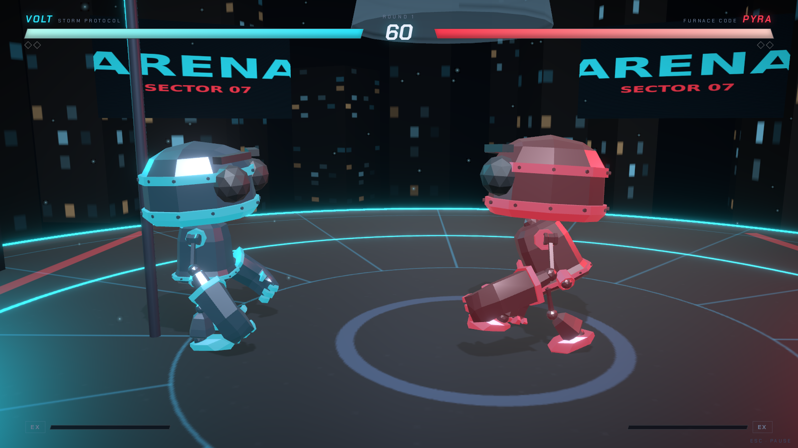

# ARENA

A browser-based 3D fighting game. Dark futuristic arenas, frame-data-driven combat,
rigged fighters, cinematic KO sequences — running at 60 FPS in modern desktop browsers.

**Current build: Milestone 1** (see [`PLAN.md`](./PLAN.md) for the full roadmap).



## Quick start

```bash
npm install
npm run dev        # → http://localhost:5173
```

Production:

```bash
npm run build      # typecheck + bundle to dist/
npm run preview    # serve the production build
```

Verification:

```bash
npm test           # 13 combat-simulation unit tests (pure logic, no DOM)
npm run typecheck  # strict TypeScript
npm run verify     # 20 headless browser checks (needs `npm run dev` running)
```

## Controls (Player 1)

| Action | Keys |
| --- | --- |
| Move | `A` / `D` |
| Block (hold) | `S` |
| Dodge (i-frames) | `SPACE` |
| Light Punch | `U` |
| Heavy Punch | `I` |
| Light Kick | `J` |
| Heavy Kick | `K` |
| Pause | `ESC` |

**EX system:** landing and blocking hits fills the EX meter. At full charge your next
heavy punch/kick becomes an unblockable EX strike (1.6× damage, guaranteed knockdown).

## What's inside

- **Deterministic 60 Hz fight simulation** (`src/game/engine.ts`) — completely decoupled
  from rendering, event-driven, unit-testable, and ready to run server-side for
  authoritative online play later.
- **Frame-data combat** — every attack has startup / active / recovery frames, range,
  lunge, knockback, hitstun, blockstun, hit-stop and meter values; one hit per
  activation; combo scaling; chip damage that can never KO.
- **Rigged skeletal fighters** with an animation state machine, crossfades, a procedural
  additive animation layer (jabs, kicks, blocks, flinches, dodges), morph-target facial
  expressions, and EX-charge glow.
- **Cinematic camera director** — separation-based framing, round intro sweep, KO orbit
  slow-motion, trauma-based shake.
- **The SECTOR 07 GRID arena** — emissive platform, boundary pylons, volumetric-style
  light cones, banner screens, instanced skyline — all textures generated procedurally.
- **Fully procedural audio** — every sound (impacts, blocks, whooshes, KO, UI, menu
  drone, fight loop) is synthesized with WebAudio. No audio files.
- **UI** — main menu with live 3D backdrop, settings (persisted), controls, roadmap,
  pause, and a results screen with per-fighter match statistics.

## Architecture

```
src/
  game/            pure simulation (no THREE/DOM imports)
    engine.ts        MatchEngine + Fighter — fixed-step deterministic fight sim
    config.ts        frame data, fighter configs, tuning constants
    ai.ts            sparring AI (Phase 4 expands this)
    input.ts         keyboard → logical actions (per-player abstraction)
    audio.ts         procedural WebAudio synth
    types.ts         shared contracts & game events
  three/           presentation layer
    Scene.tsx        Canvas + fixed-step driver + postprocessing
    RobotFighter.tsx skeletal anim state machine + procedural layer
    CameraRig.tsx    camera director + screen shake
    ArenaEnvironment.tsx
    EffectsLayer.tsx particles, shockwaves, flashes, audio bridge
    textures.ts      procedural canvas textures
  ui/              HUD & screens (React DOM, rAF-driven, re-render-free HUD)
  state/store.ts   Zustand app state + persisted settings
tests/             vitest — combat rules (multi-hit, chip, EX, KO, rounds, bounds)
scripts/           headless visual verification (Playwright + SwiftShader)
```

## Assets & credits

- Fighter model: **“RobotExpressive”** by Tomás Laulhé, modified by Don McCurdy —
  CC-BY, from the three.js example assets (`public/models/RobotExpressive.glb`).
- Fonts: Chakra Petch (SIL OFL), self-hosted in `public/fonts/`.
- Everything else (textures, audio, arena, code) is generated by this repository.

## Deployment

**`DEPLOYMENT.md`** covers shipping the production build to **Vercel** and
**Render** (turnkey configs `vercel.json` + `render.yaml` are already in the repo;
no environment variables are required for the current build).

```bash
npm ci && npm run build && npm run preview   # verify the exact deploy artifact locally
```

## Dev/test URLs

- `#play` — jump straight into a match
- `#play&ko` — auto-KO once combat starts (tests the KO cinematic)
- `#play&results` — auto-finish to the results screen
- `#play&low` — force low quality (software-renderer friendly)
